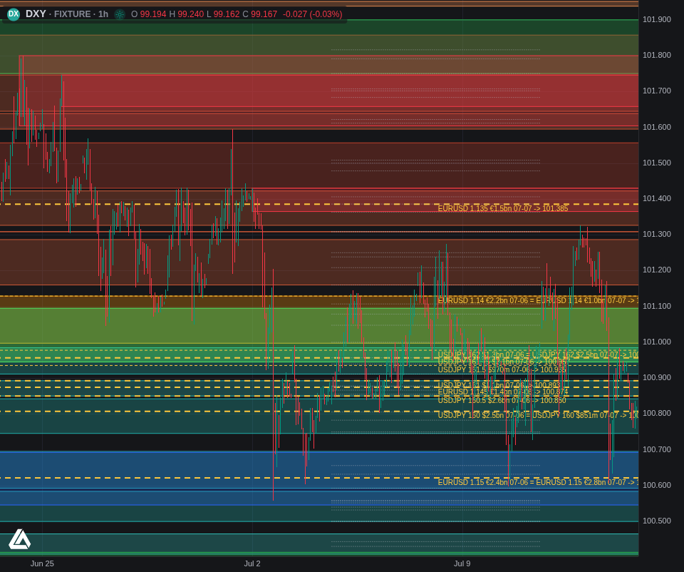
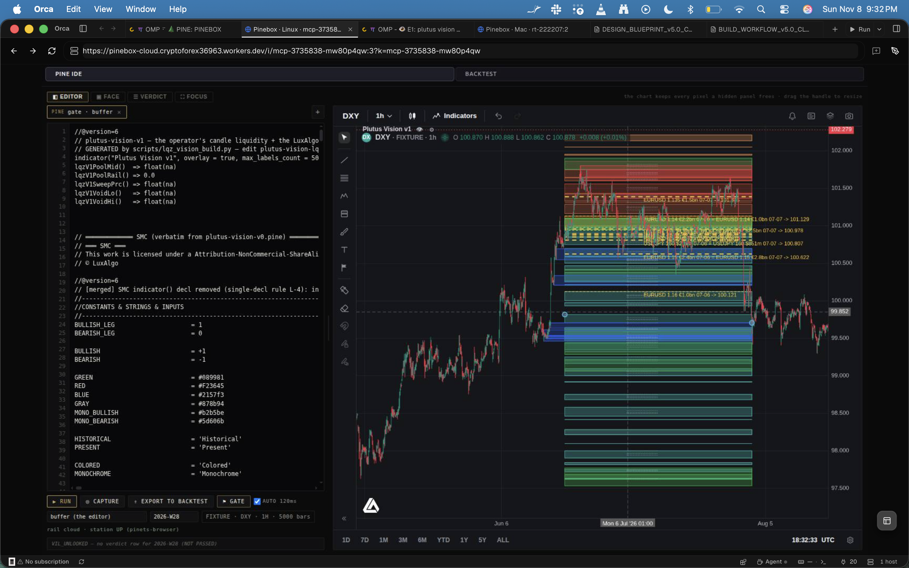
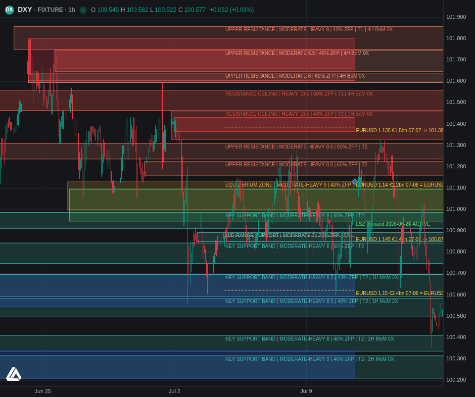
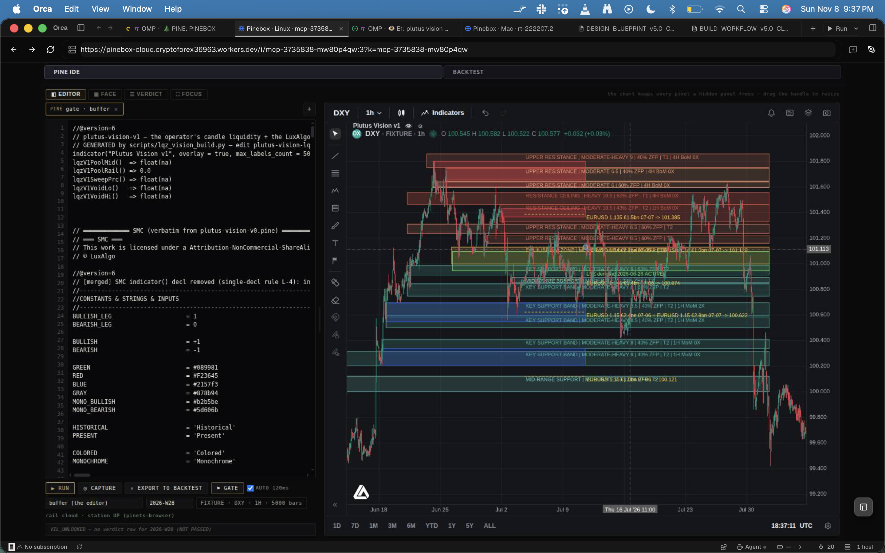

# VISUAL CHECKPOINTS LOG — PLUTUS VISION M1 (DXY, golden week 2026-07-06)

The visual rolodex of the M1 build. **One entry per visual checkpoint. Every entry carries the picture of the
real Pinebox runtime AND the commit that holds the exact code, card and composition that produced that picture.**
To go back to a state: find the picture you want below, then run its **Restore** block. Nothing else is needed.

Append-only. A new checkpoint appends a new entry at the end; an entry's commit hash is back-filled by the
next commit (a commit cannot name its own hash), and every checkpoint also gets the tag `vc/<checkpoint-id>`,
which resolves without the back-fill.

---

## HOW A VISUAL CHECKPOINT IS MADE (the contract every entry below follows)

1. **Generate** the card and the composition from the source tree:
   `bun m1/src/run.ts DXY 2026-07-06` (writes `m1/out/e1-card-DXY-2026-07-06.json`, see m1/src/run.ts:18)
   `bun m1/src/compose.ts DXY 2026-07-06` (writes `m1/out/plutus-vision-v5-e1-DXY-2026-07-06.pine`, see m1/src/compose.ts:22)
2. **Load** the composition in Pinebox with the `pinebox` tool (`verb=load`, `pine=<composition>`, `pair=DXY`, `tf=1H`).
3. **Frame** the golden week with the tool: `verb=chart op=zoom dir=IN` until the span is about three weeks, then
   `verb=chart op=pan dx=<fraction>` (each response returns the new range; one screen = `dx=-1`).
4. **Capture** with `verb=shot section=chart`; OPEN the PNG; write what it shows against the oracle.
5. **Commit** the source + card + composition + the PNG + `checkpoint.json` + `comparison.json` + `m1/state.json`
   in ONE commit with `PV-Gate: checkpoint` and `PV-Checkpoint: m1/checkpoints/<id>/checkpoint.json`.
   The M1 gate (gates/commit_gate.py:199) checks the PNG hashes against comparison.json and the external grader
   reads the pictures before the branch moves.
6. **Tag** the commit `vc/<id>` and append the entry here (image + commit + restore block + what it shows).

The rule: **no picture without its commit, no commit of a visual change without its picture.** Every operator
screenshot of the runtime is stored beside the runtime capture of the same composition.

## HOW TO RESTORE ANY ENTRY

```bash
cd /home/leviathan/JARVIS_WORKSPACE/Shared_Workspace/PLUTUS_VISION
C=$(git rev-parse vc/CP-001)                      # or the hash printed in the entry
mkdir -p /tmp/restore-CP-001 && git archive "$C" | tar -x -C /tmp/restore-CP-001   # touches no ref
cd /tmp/restore-CP-001
bun m1/src/run.ts DXY 2026-07-06 && bun m1/src/compose.ts DXY 2026-07-06
sha256sum m1/out/plutus-vision-v5-e1-DXY-2026-07-06.pine      # must equal the entry's composition sha
```

Then load that `.pine` in Pinebox and frame the entry's recorded range. The bar inputs are outside git (the
Pinebox TradingView store `~/.local/share/pinebox/data/tv-bars/TVC_DXY/{60,240,15}/*.json`); each checkpoint
records the sha256 of every bar month it read (`bar_inputs_sha256` in its checkpoint.json), so a changed store
is detected, never silently absorbed. To make the branch itself point at a checkpoint, that is an operator
decision (a reset is a ref change the M1 gate grades) — ask, then do it through the gate.

---

## VC-000 — first E1 render, before the commit protocol (2026-11-08 ~21:30 local) — NOT RESTORABLE




- **Commit:** NONE. The code that produced these pictures was edited before any commit existed; the exact
  composition bytes are gone. Recorded so the history is honest, not so it can be restored.
- **What it showed:** every card zone drawn (43 zones, MINIMAL..HEAVY) as full-width boxes from 14 days before
  the week to 21 days after, every option conversion labelled (USD/JPY, USD/CHF and EUR/USD), every intra-zone
  line drawn. The chart read as a tiled price axis.
- **Operator verdict (verbatim):** "Which good in that it's catching all of the zones. I can see that a lot of
  this is aligning to real candles, even if it's not extended to the left properly, touching the origin candles
  ... This obviously needs to be optimized so that the charts are still legible, and that we don't have literally
  the entire fucking screen covered in zones."
- **Measured:** runtime-r1.png sha256 d35dbb34cb419bae98b817bd8f663bc7e0650e9903aa26996b000bd90b8b7008;
  operator-orca-2026-11-08-2132.png sha256 974c30a8c1816b83cdafe052f9fe260c92e7a5ac2827e90a52392019f0c26e26.

---

## VC-001 — CP-001 — legibility pass: MODERATE+ in the measured band, boxes from their origin candle (2026-11-08 21:45 local)




- **Commit:** `8ae7388d421703d97d98187e9d260d903d1b3573` · tag `vc/CP-001` (gate: PASS checkpoint, external grader PASS 8)
- **Restore proven:** `git archive vc/CP-001` into /tmp/restore-CP-001, generated outputs deleted, regenerated from the
  archived source -> composition sha256 c9261fb3f5a0fb9b480aa08b3f870d0dddf54746b30b342bd75788545a1c3684 (identical)
- **Composition:** `m1/out/plutus-vision-v5-e1-DXY-2026-07-06.pine` sha256 `c9261fb3f5a0fb9b480aa08b3f870d0dddf54746b30b342bd75788545a1c3684`
  (regenerated twice from the committed tree: identical)
- **Card:** `m1/out/e1-card-DXY-2026-07-06.json` sha256 `07bce57fe2a937ffb19bb81256bff0ffe542a5bb5eb27c3dc0d6f1fad3a23af1`
- **Runtime:** Pinebox Cloud, Orca Linux tab, instance 3; load result 5000 bars, 24 boxes, 50 labels, 86 lines, 1 table.
- **Frame:** 2026-06-23T10:00Z .. 2026-07-16T04:00Z (`from 1782208800000 to 1784174400000`).
- **Picture sha256:** runtime-state.png `3ae1a18d0983329edae6b40db936724b446e97f193d811782a5d505fb1e19287`;
  operator-orca-2026-11-08-2137.png `e618b512908794b54dd20f0cb314a83eab9ff96384aa76261f4de9ef40da7b3f`.
- **What changed from VC-000 (and why it moved in the right direction):**
  - only zones scoring MODERATE+ (>= 6) are drawn — the canon's chart synthesis tier — the rest stay in the card
    (m1/src/compose.ts:31);
  - only zones inside a display band measured per asset per week are drawn: spot +/- max(prior-week range,
    mean of the last 4 weekly ranges) = 99.869..102.143 for this week (m1/src/run.ts:72) — no fixed price;
  - every zone box starts at the candle that formed it (`origin`, m1/src/assemble.ts:142) instead of a fixed
    left edge — this is what the operator pointed at ("touching the origin candles");
  - one label per zone at the week open; option lines only for the P8 primary EUR/USD strikes;
  - POI tiers only on real IP zones (MODERATE+ on their own levels) and the structural dimension scored by its
    canon wording, which stopped every level scoring HEAVY (m1/src/assemble.ts:53, :107).
- **Operator verdict (verbatim):** "This is already an improvement. Much less clutter, much more legible. Still
  some optimization to be done ... This is not fully approved yet, but we are moving in the right direction."
- **Outcome table (m1/checkpoints/CP-001/outcome.txt):** 8 zones inside the week range, 7 tested, ZFP
  prediction correct on 3 (42.9%). Target is 95%+.
- **Families (m1/checkpoints/CP-001/comparison.json):** MATCHED 2 · WRONG 7 · MISSING 3 · UNOBSERVABLE 1.
- **Open against the oracle:** resistance stack above the week high (4 of 7 bands above 101.275); the 101.19-101.275
  rejection band predicted to BREAK but held; the 100.61-100.68 1H BoM labelled MoM; no LSZ for the Jul 10 sweep
  to 100.598; reaction counts, intra-zone and core/spike not on the chart; the E1 table not visible.

---

## WHAT IS MOVING THIS BUILD IN THE RIGHT DIRECTION (keep doing these; read before any change)

1. **Drive Pinebox with the `pinebox` tool only** — `load`, `chart op=view|zoom|pan`, `shot`. No CDP scripts, no IDE
   source reading. The tool returns the range after every move; use it to land on the week. (Operator: "The tool has
   everything built in ... If there's a problem, you are the problem.")
2. **Every number on the chart comes from the card**, and the card comes from the bars on disk plus the Protocol A
   evidence (m1/evidence/protocol-a/extraction.json:1). No week-specific price is typed anywhere.
3. **Legibility is a rule, not a taste:** draw the synthesis (MODERATE+), inside the measured weekly band, from
   the origin candle, one label per zone. Everything else stays inspectable in the card.
4. **Measure against the week after every change** with `bun m1/src/evaluate.ts DXY 2026-07-06` and look at the
   capture next to the oracle images. The table is the numbers; the opened picture is the verdict.
5. **Commit every picture with its code** (this log). A change that is not committed cannot be restored, and
   VC-000 is the proof of what that costs.
